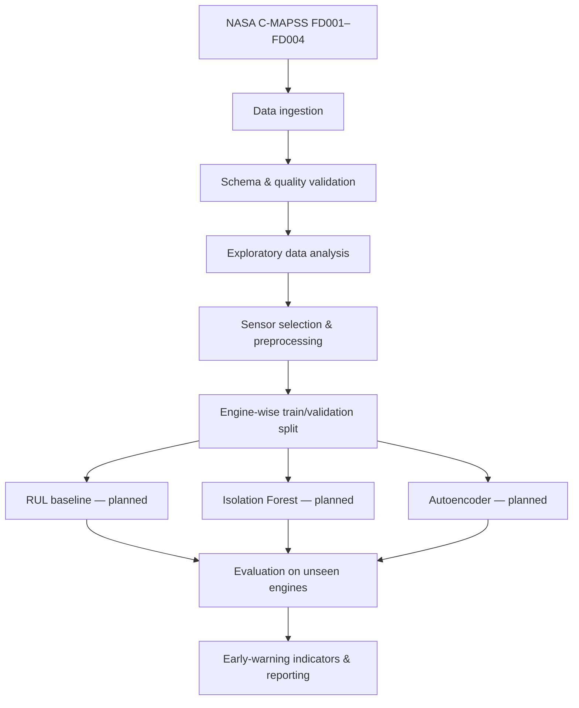

# Aero Sentinel — architecture draft (v0.2)

## Goal

Explore early-warning approaches for simulated turbofan degradation using NASA C-MAPSS. **C-MAPSS does not label the exact physical onset of degradation.** Any early-warning target must be operationally defined and validated rather than presented as a ground-truth damage onset.

## Data pipeline

## Implemented in this branch

- `data.py`: whitespace-delimited data ingestion, schema validation, RUL loading, quality statistics.
- `first_data_test.py`: FD001 quality report and exploratory sensor plots.
- `dataset_overview.py`: comparison across FD001–FD004, CSV/JSON outputs.
- `tests/test_data.py`: synthetic fixtures to check validation behavior.

## Planned (not implemented)

- RUL target generation for training engines and leakage-safe splitting by engine.
- Scaling fitted on training engines only, sensor selection and time-window features.
- RUL regression baseline and anomaly-detection baselines.
- Evaluation using MAE/RMSE, false-alert rate, warning lead time and ablation studies.

## Research cautions

1. The training sets contain complete run-to-failure sequences; the test sets are truncated and include RUL at the last observed cycle.
2. Do not randomly split rows from the same engine across training and validation.
3. FD002 and FD004 have multiple operating conditions; preprocessing may need condition-aware treatment.
4. Plots are descriptive; they do not establish predictive performance.
5. Keep NASA raw data out of git; reproduce results from local `data/raw/`.
